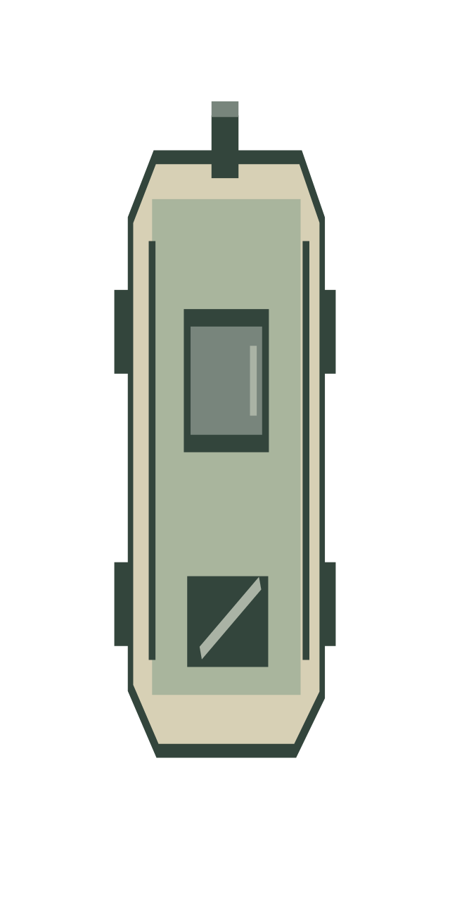
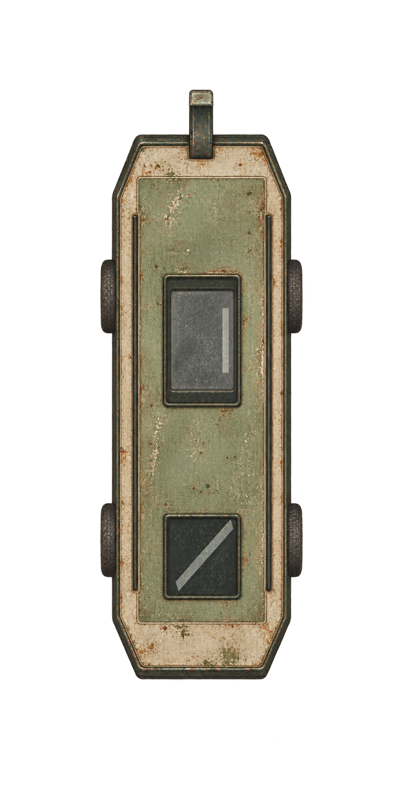
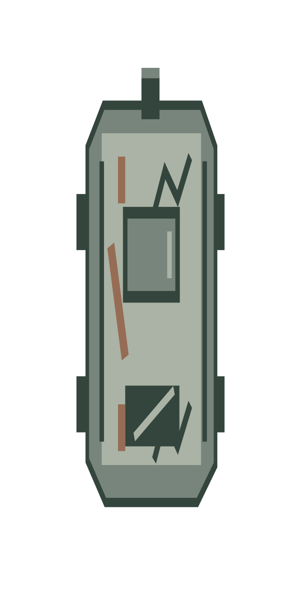
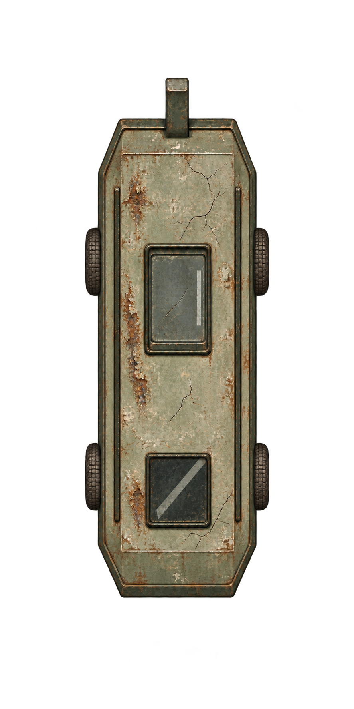

# DEADWALL — Art235 : Caravanes fermées

**2 PNG finaux et 1 sortie(s) remplacée(s)** sont conservés dans leurs octets natifs, avec prompts effectivement envoyés, références, dimensions auteur, historique et empreintes SHA256.

| Identité | Objet | Emprise X × Y (m) | Hauteur auteur (m) |
|---|---|---:|---:|
| `prop:touring-caravan:v0` | Caravane tractable fermée | 2.4 × 6.2 | 2.8 |
| `prop:abandoned-caravan:v0` | Caravane abandonnée fermée | 2.4 × 6.2 | 2.8 |

## Sources et périmètre

Les objets existent déjà dans les sources de la révision `f3ba02a5b73a55120c02c21d5703902ea3e901d9`. Les nouvelles images sont des propositions dédiées à leur type ; leur rendu procédural actuel reste présent. Des images analogues existent dans les atlas génériques. Ce pack ne transforme pas des plans auteur agricoles ou industriels en installations de campagne et n’affirme pas une absence de toute image analogue.

Les références canoniques utilisent l’entrée publique `drawProp`, qui délègue à `drawPropBase` privé, avec variante 0, `stateAlpha:false` et sans objet `game`. Les surimpressions de service et d’eau restent donc inactives. La géométrie et les cotes sont issues du code inchangé ; ce sont des choix auteur, pas des mesures constructeur. Pour les caravanes, seule l’instance parcelle 1 de V01 est représentée : toit et intérieur fermés, axe long Y, attelage vers −Y. La famille complète possède d’autres longueurs.

## Contrôles et contenu

- `assets/art235/props/` : images finales natives, sans réencodage.
- `references/iterations/` : sorties remplacées, lorsqu’une correction a été nécessaire.
- `references/` : références canoniques, atlas réellement fourni, sources inchangées et index vérifié contre Git.
- `generation-history.json` : chaque prompt réellement envoyé, ses images de référence et la sortie retenue ou remplacée.
- `records/` : préparation et enregistrements originaux, y compris les scripts de rendu.
- `qa/` : revue visuelle liée au SHA256, décodage PNG, chunks, dimensions et mesures alpha.
- `SHA256SUMS.txt` : tous les fichiers du pack, hors manifeste lui-même.

Les PNG possèdent un canal alpha et des marges autour du corps visible. Les pixels d’alpha très faible sont mesurés séparément ; cette vérification n’affirme pas un alpha strictement nul partout autour du sprite. Toutes les métadonnées natives restent conservées par copie exacte des octets.

**Propositions source uniquement.** La fidélité métrique ou pixel pour pixel 1:1 n’est pas certifiée. Échelle, ancrage, orientation, clipping et apparence en jeu restent à qualifier lors d’une intégration distincte. Aucune source du moteur, identité, sauvegarde, génération, collision, dépendance ou test n’est modifié par ce pack.

## Comparaison visuelle

### Caravane tractable fermée

`prop:touring-caravan:v0`

| Référence canonique v0 | Proposition source retenue |
|---|---|
|  |  |

### Caravane abandonnée fermée

`prop:abandoned-caravan:v0`

| Référence canonique v0 | Proposition source retenue |
|---|---|
|  |  |
