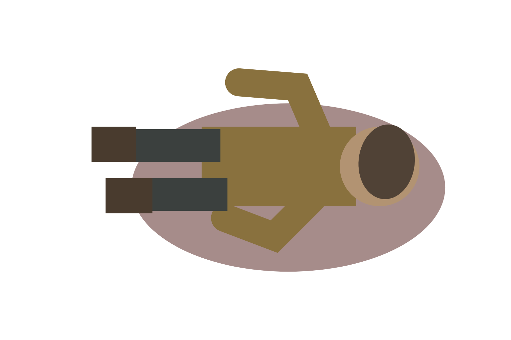
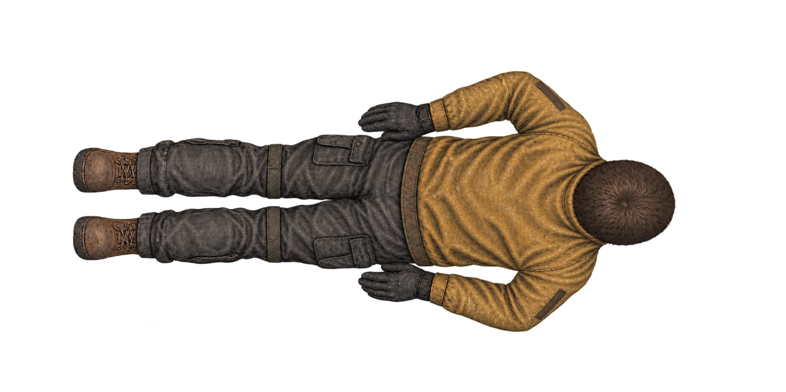

# DEADWALL — Art236 : Dépouille inerte du survivant

**1 PNG finaux et 1 sortie(s) remplacée(s)** sont conservés dans leurs octets natifs, avec les prompts effectivement envoyés, les références exactes, l’historique et les empreintes SHA256.

| Identité de proposition | Sujet | Géométrie déclarée par la source |
|---|---|---|
| `succession:body` | Dépouille persistante du survivant | Schéma du corps ; aucune cote anatomique certifiée |

## Sources et périmètre

Révision source : `12e0aa4aa77b9901bd53eb7a8771382a5f753593` ; arbre Git : `663ad5750e49ae401fc0b46bfdebc28942ad1617`.

La dépouille inerte possède déjà un rendu Canvas visible. Cette proposition apporte un sprite dédié au corps ; Art137 prone représente un vivant et sert de référence d’identité et de matières. Le fallback canonique conserve sa marque de sol d’origine, alors que la proposition représente le corps seul.

La référence vient de l’entrée de profondeur réelle de succession133, à angle nul. Ses formes schématiques n’établissent ni une taille anatomique, ni un pivot raster métrique. Les états vivant, relevé ou infecté ne sont pas couverts.

## Contrôles et contenu

- `assets/art236/actors/` : images finales natives, sans réencodage.
- `references/iterations/` : sorties remplacées lorsqu’une correction a été nécessaire.
- `references/` : références canoniques, images réellement fournies et sources vérifiées contre Git.
- `generation-history.json` : chaque prompt ayant produit un PNG, ses références exactes et sa sortie retenue ou remplacée.
- `records/` : préparation originale et reçus, notamment le rejeu indépendant des références canoniques.
- `qa/` : revue liée au SHA256, décodage PNG, chunks, dimensions de fichier et mesures alpha.
- `gallery.html` : comparaisons canoniques/finales avec les fichiers natifs liés directement.
- `SHA256SUMS.txt` : tous les fichiers du pack, hors manifeste lui-même.

Les pixels d’alpha très faible sont mesurés séparément. Des marges autour du corps visible n’impliquent pas un alpha strictement nul partout autour du sujet. Les métadonnées natives restent préservées par copie exacte des octets.

**Propositions source uniquement.** La fidélité métrique ou pixel pour pixel 1:1 n’est pas certifiée. Échelle, ancrage, orientation, clipping et apparence en jeu restent à qualifier lors d’une intégration distincte. L’assembleur ne modifie aucune source du moteur, sauvegarde, identité, collision, dépendance ou test.

## Comparaison visuelle

### Dépouille persistante du survivant

`succession:body`

| Référence canonique existante | Proposition source retenue |
|---|---|
|  |  |
