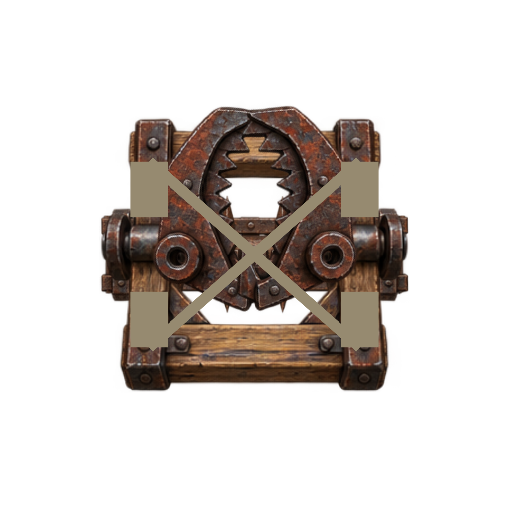
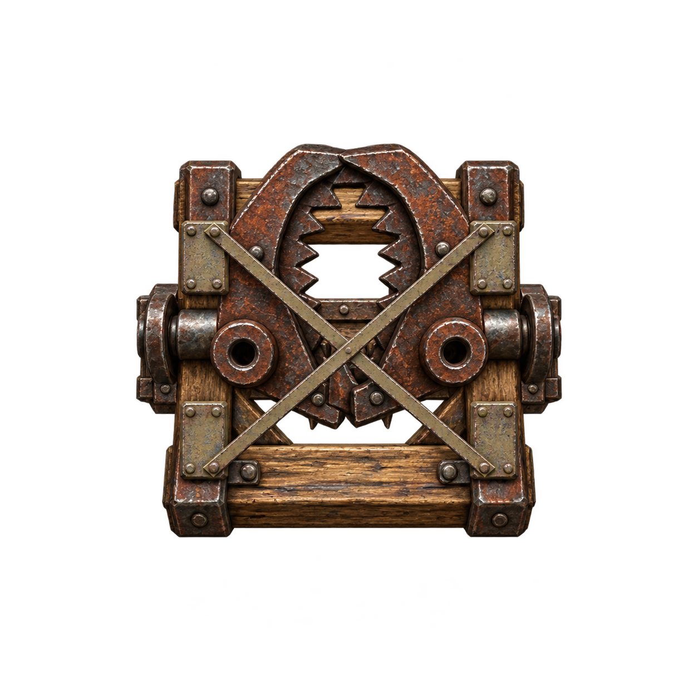
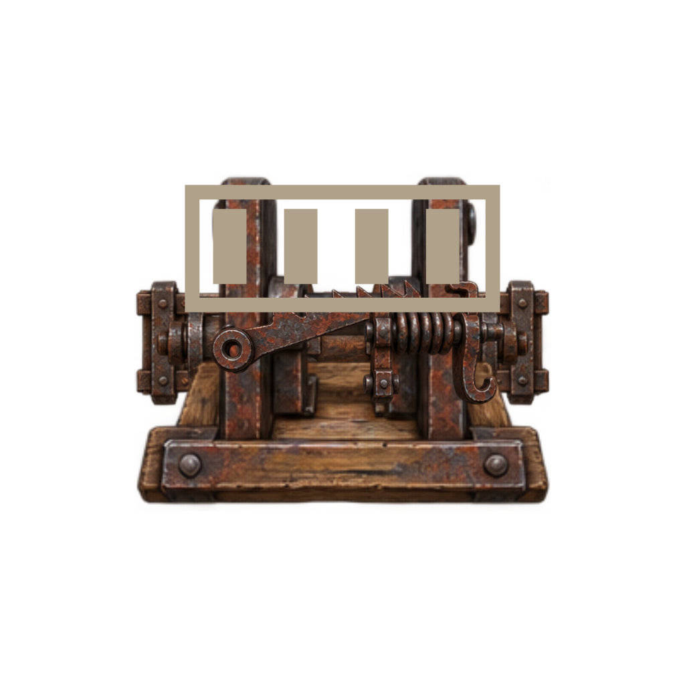
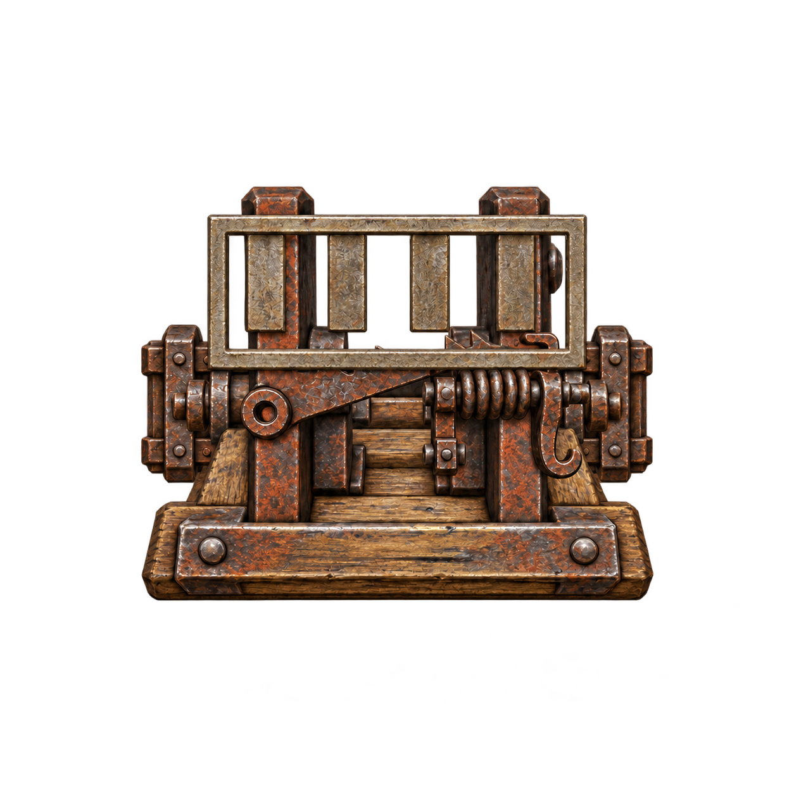
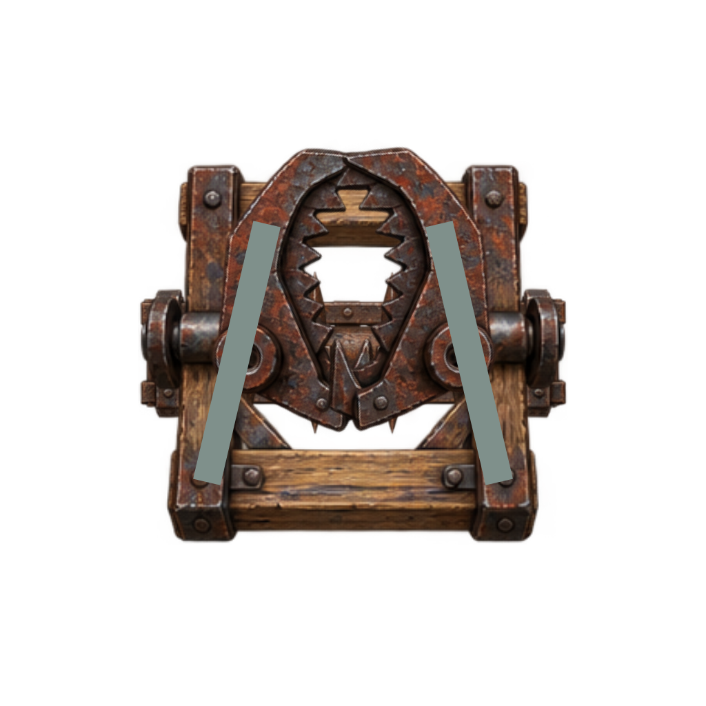
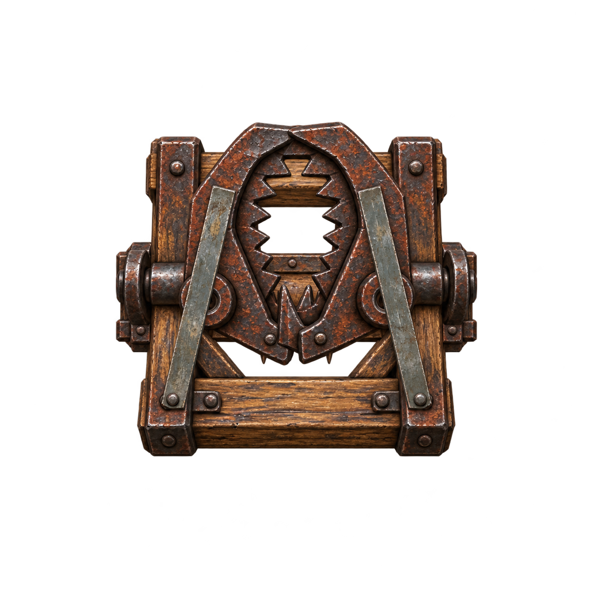
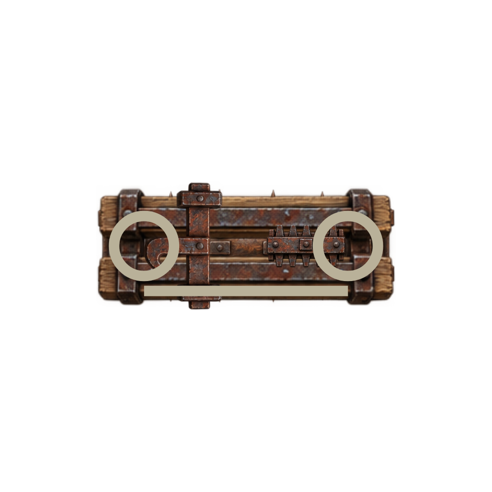
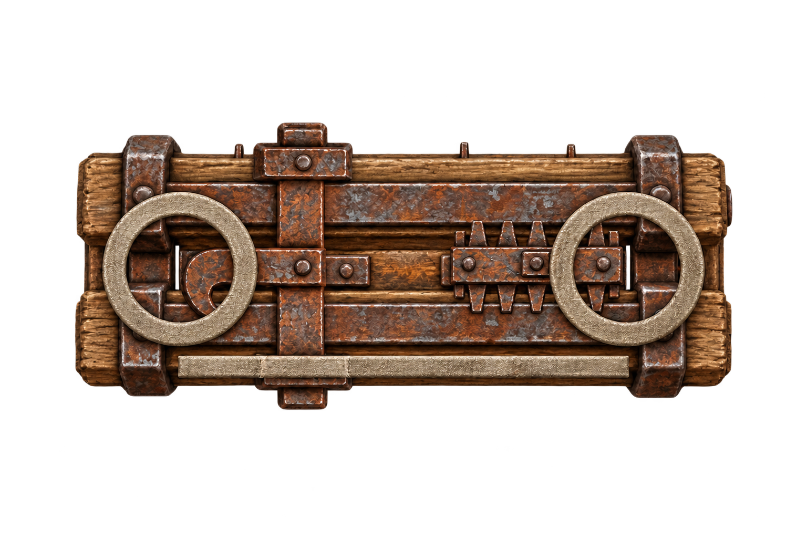
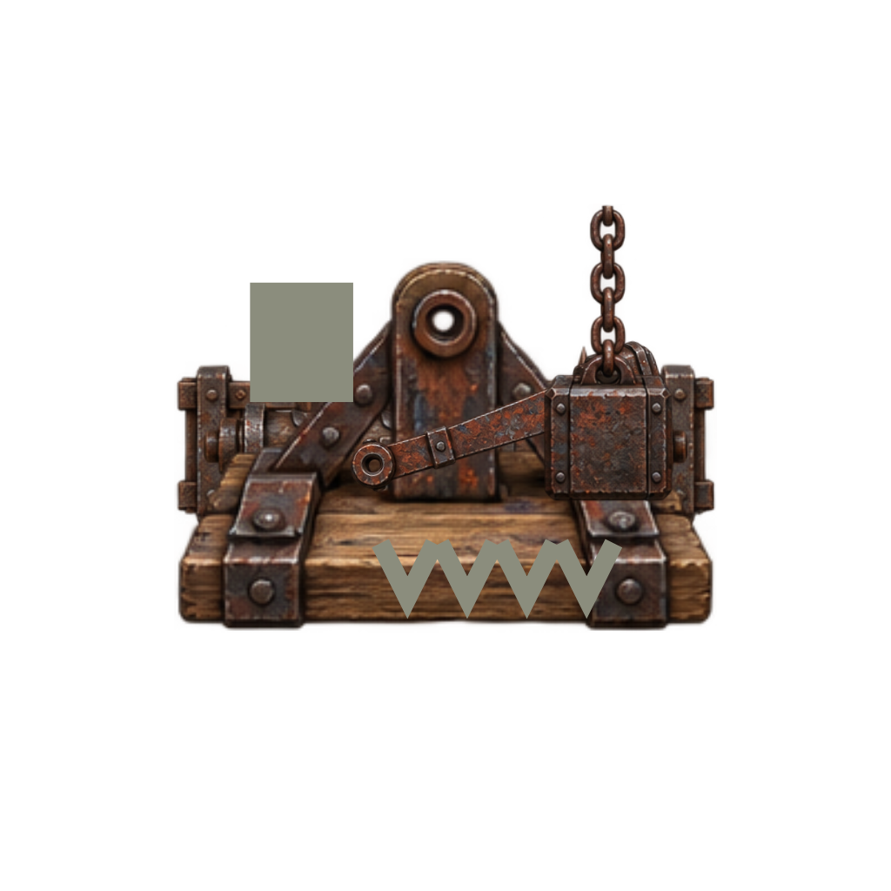
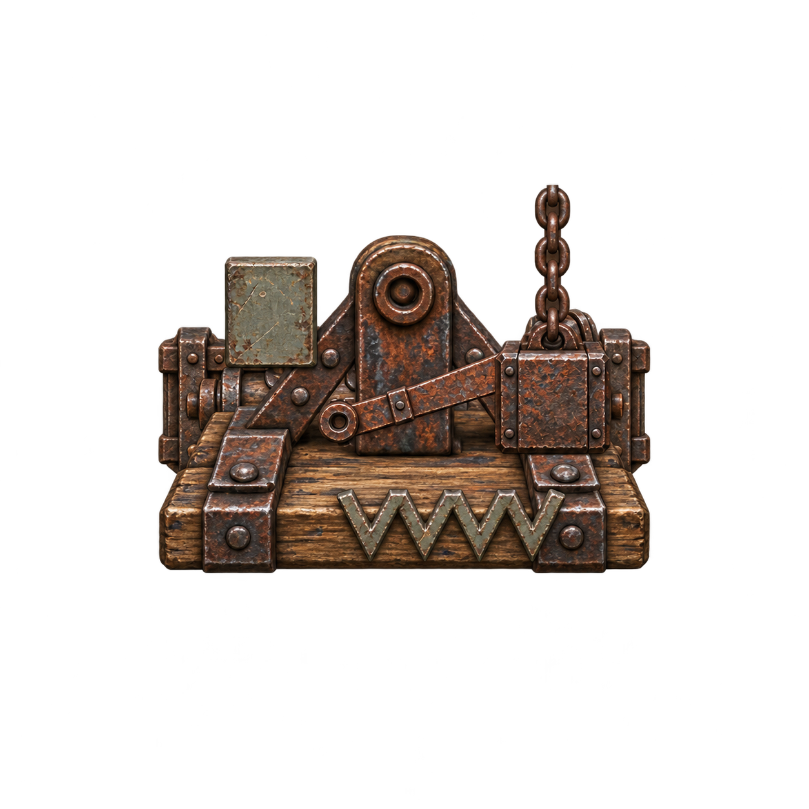

# DEADWALL — Art237 : Mécanismes spécialisés montés — 5 proposition(s) retenue(s) sur 6 cibles

**5 PNG finaux et 2 sortie(s) remplacée(s)** sont conservés dans leurs octets natifs, avec les prompts effectivement envoyés, les références exactes, l’historique et les empreintes SHA256.

**Livraison partielle : 5 proposition(s) acceptée(s), 1 cible(s) bloquée(s), sur 6 cibles prévues.** Les 2 reçus d’échec sont conservés ; une cible bloquée ne reçoit aucune image de substitution ni revue d’acceptation.

| Identité de proposition | Sujet | Géométrie déclarée par la source |
|---|---|---|
| `mechanism:breachClamp193:v0:armed-mounted` | Mâchoire anti-briseurs | Support auteur 1 × 1 m ; hauteur du mécanisme non déclarée |
| `mechanism:enduranceRack193:v0:armed-mounted` | Râtelier de dents de relève | Support auteur 1 × 1 m ; hauteur du mécanisme non déclarée |
| `mechanism:shieldTongs193:v0:armed-mounted` | Pinces anti-protections | Support auteur 1 × 1 m ; hauteur du mécanisme non déclarée |
| `mechanism:quickCable193:v0:armed-mounted` | Bobines de couverture rapide | Support auteur 1 × 1 m ; hauteur du mécanisme non déclarée |
| `mechanism:siegeBrake193:v0:armed-mounted` | Frein à chaîne de siège | Support auteur 1 × 1 m ; hauteur du mécanisme non déclarée |

## Sources et périmètre

Révision source : `12e0aa4aa77b9901bd53eb7a8771382a5f753593` ; arbre Git : `663ad5750e49ae401fc0b46bfdebc28942ad1617`.

Les six mécanismes existent déjà, avec leurs pièces d’atlas Art159, leurs ajouts Canvas193 et leurs animations. Chaque proposition statique représente l’assemblage armé sur son support Hérisson. Les identifiants du pack décrivent les images ; la clé runtime du mécanisme reste inchangée.

Les références utilisent drawSpikes puis drawMechanism, variante 0, phase armée et mouvement nul. L’emprise auteur du support est de 1 × 1 m. Aucune hauteur propre au mécanisme n’est déclarée ; aucune hauteur n’est déduite. Les phases actives et les autres variantes ne sont pas couvertes.

## Contrôles et contenu

- `assets/art237/mechanisms/` : images finales natives, sans réencodage.
- `references/iterations/` : sorties remplacées lorsqu’une correction a été nécessaire.
- `references/` : références canoniques, images réellement fournies et sources vérifiées contre Git.
- `generation-history.json` : chaque prompt ayant produit un PNG, ses références exactes et sa sortie retenue ou remplacée.
- `generation-failures.json`, `records/preparation/generation-prompts.json` et `records/calls/` : les 2 refus du service, leurs prompts effectivement envoyés et leurs reçus sont archivés séparément ; ils ne sont pas comptés comme sorties PNG.
- `records/` : préparation originale et reçus, notamment le rejeu indépendant des références canoniques.
- `qa/` : revue liée au SHA256, décodage PNG, chunks, dimensions de fichier et mesures alpha.
- `gallery.html` : comparaisons canoniques/finales avec les fichiers natifs liés directement.
- `SHA256SUMS.txt` : tous les fichiers du pack, hors manifeste lui-même.

Les pixels d’alpha très faible sont mesurés séparément. Des marges autour du corps visible n’impliquent pas un alpha strictement nul partout autour du sujet. Les métadonnées natives restent préservées par copie exacte des octets.

**Propositions source uniquement.** La fidélité métrique ou pixel pour pixel 1:1 n’est pas certifiée. Échelle, ancrage, orientation, clipping et apparence en jeu restent à qualifier lors d’une intégration distincte. L’assembleur ne modifie aucune source du moteur, sauvegarde, identité, collision, dépendance ou test.

## Comparaison visuelle

### Mâchoire anti-briseurs

`mechanism:breachClamp193:v0:armed-mounted`

| Référence canonique existante | Proposition source retenue |
|---|---|
|  |  |

### Râtelier de dents de relève

`mechanism:enduranceRack193:v0:armed-mounted`

| Référence canonique existante | Proposition source retenue |
|---|---|
|  |  |

### Pinces anti-protections

`mechanism:shieldTongs193:v0:armed-mounted`

| Référence canonique existante | Proposition source retenue |
|---|---|
|  |  |

### Bobines de couverture rapide

`mechanism:quickCable193:v0:armed-mounted`

| Référence canonique existante | Proposition source retenue |
|---|---|
|  |  |

### Frein à chaîne de siège

`mechanism:siegeBrake193:v0:armed-mounted`

| Référence canonique existante | Proposition source retenue |
|---|---|
|  |  |

## Cibles bloquées — backlog

Les sources et références des cibles prévues restent conservées. Les états exacts et reçus SHA figurent dans `backlog/blocked-targets.json` et `generation-failures.json`.

| Identité prévue | Blocage constaté | Source conservée |
|---|---|---|
| `mechanism:runnerCable193:v0:armed-mounted` | ImageGen safety system returned HTTP 400 moderation_blocked for violence on input, then on output after one clarification of the static fictional depiction. No image was delivered. No further attempt is authorized for this target in this batch. | [Référence canonique](references/canonical/runnerCable193-v0-armed-mounted.png) |
