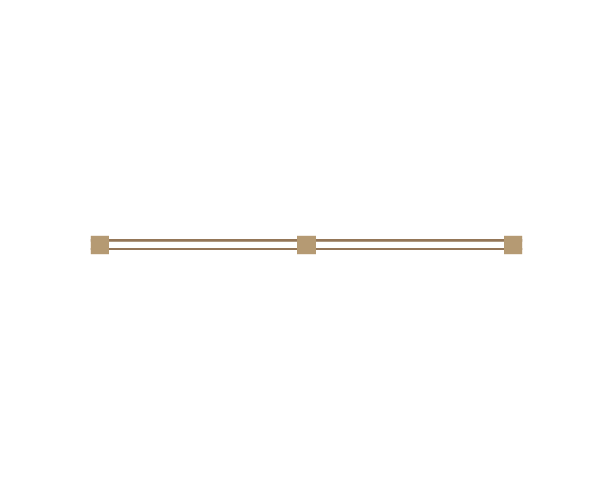
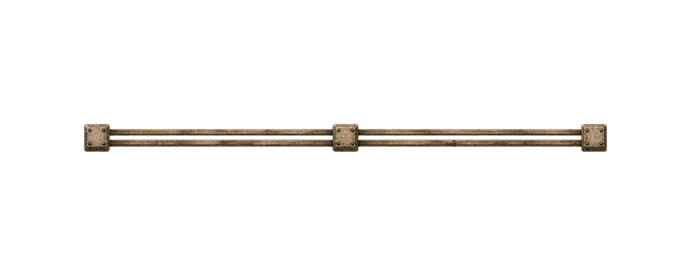
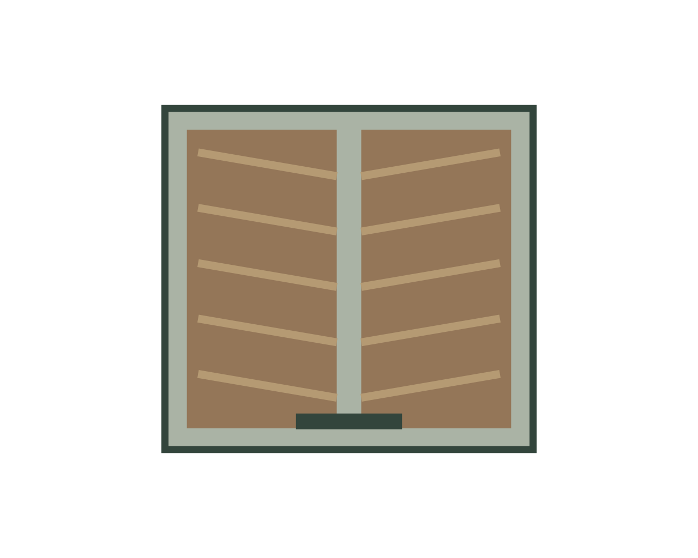
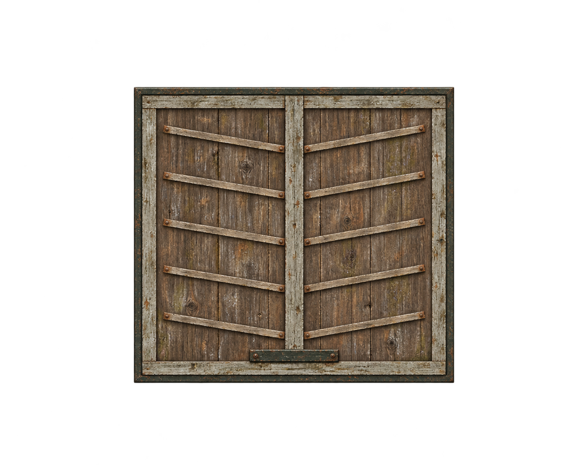
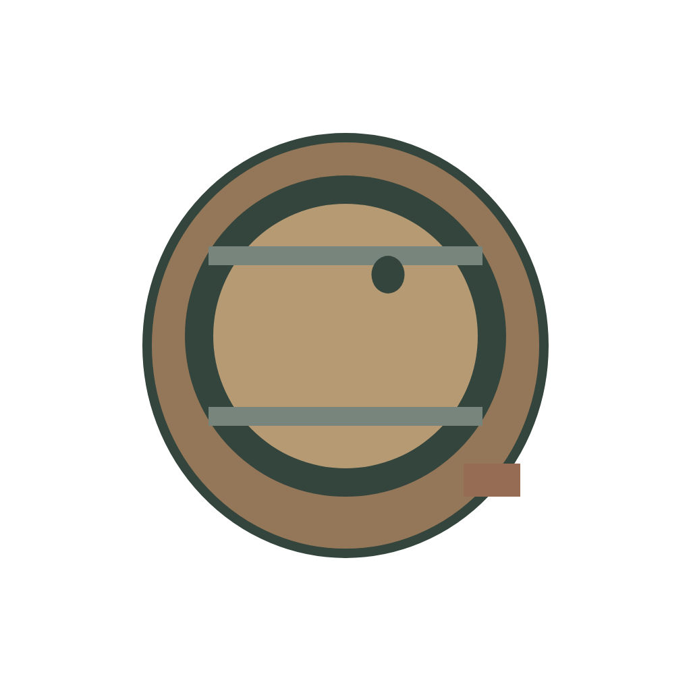
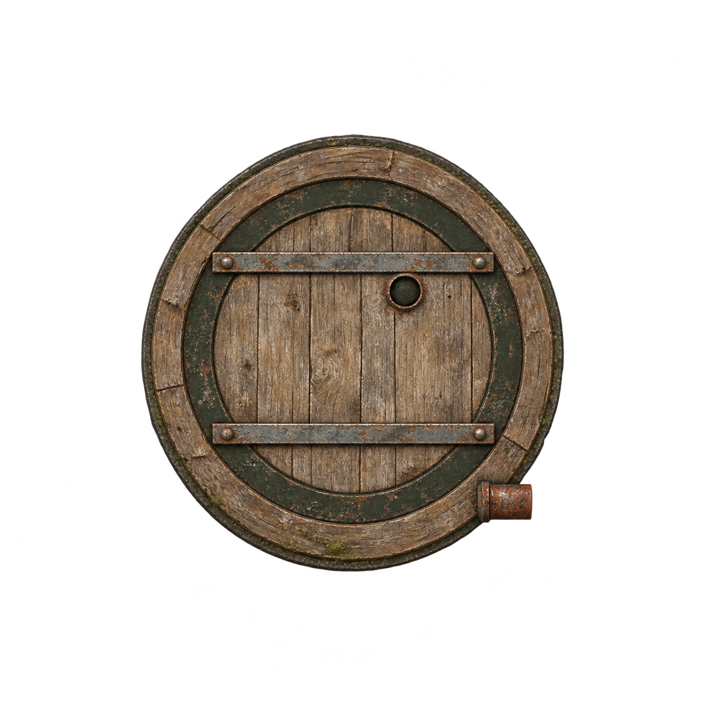
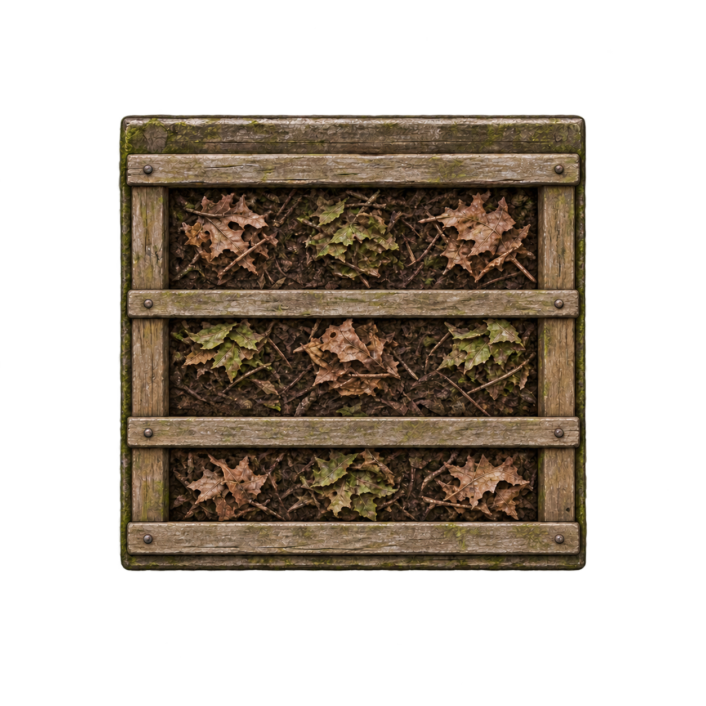
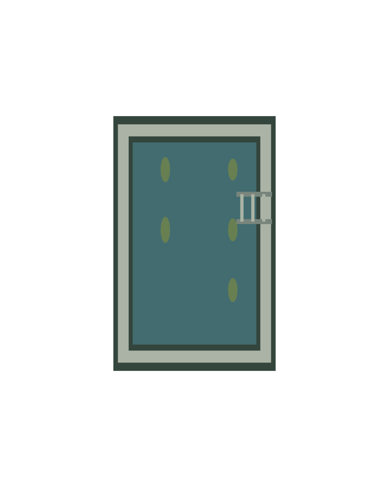
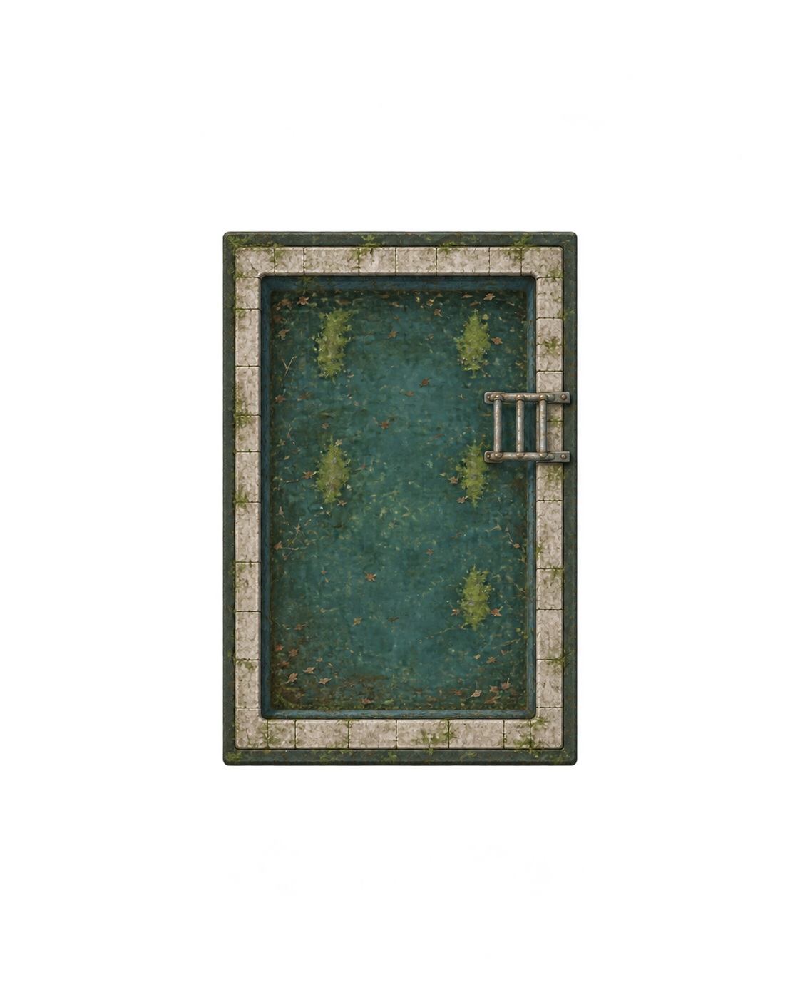

# DEADWALL — Art238 : Structures et équipements de parcelles

**5 PNG finaux et 1 sortie(s) remplacée(s)** sont conservés dans leurs octets natifs, avec les prompts effectivement envoyés, les références exactes, l’historique et les empreintes SHA256.

| Identité de proposition | Sujet | Géométrie déclarée par la source |
|---|---|---|
| `prop:fence:v0` | Segment de clôture en bois | 3 × 0.15 m ; hauteur auteur 1.2 m |
| `prop:garden-shed:v0` | Abri de jardin fermé | 3.4 × 3.3 m ; hauteur auteur 2.4 m |
| `prop:rain-barrel:v0` | Tonneau de pluie inactif | 0.7 × 0.7 m ; hauteur auteur 1 m |
| `prop:compost-bin:v0` | Composteur de jardin | 1 × 1 m ; hauteur auteur 1 m |
| `prop:closed-pool:v0` | Bassin extérieur fermé au public | 8 × 12 m ; hauteur auteur 0.4 m ; profondeur auteur 1.4 m |

## Sources et périmètre

Révision source : `12e0aa4aa77b9901bd53eb7a8771382a5f753593` ; arbre Git : `663ad5750e49ae401fc0b46bfdebc28942ad1617`.

Les cinq objets possèdent déjà un rendu structural205. Des images analogues existent dans Art153, Art157 ou Art158 et sont documentées par cible. Ces propositions concernent les instances auteur choisies ; elles ne certifient pas une absence de toute image analogue.

Les références utilisent drawProp, qui délègue à drawPropBase privé, avec les dimensions des instances auteur exactes, la variante 0 et stateAlpha:false, sans objet game. Les surimpressions de service et d’eau sont inactives. Une instance ne représente pas toutes les dimensions de sa famille.

## Contrôles et contenu

- `assets/art238/props/` : images finales natives, sans réencodage.
- `references/iterations/` : sorties remplacées lorsqu’une correction a été nécessaire.
- `references/` : références canoniques, images réellement fournies et sources vérifiées contre Git.
- `generation-history.json` : chaque prompt ayant produit un PNG, ses références exactes et sa sortie retenue ou remplacée.
- `records/` : préparation originale et reçus, notamment le rejeu indépendant des références canoniques.
- `qa/` : revue liée au SHA256, décodage PNG, chunks, dimensions de fichier et mesures alpha.
- `gallery.html` : comparaisons canoniques/finales avec les fichiers natifs liés directement.
- `SHA256SUMS.txt` : tous les fichiers du pack, hors manifeste lui-même.

Les pixels d’alpha très faible sont mesurés séparément. Des marges autour du corps visible n’impliquent pas un alpha strictement nul partout autour du sujet. Les métadonnées natives restent préservées par copie exacte des octets.

**Propositions source uniquement.** La fidélité métrique ou pixel pour pixel 1:1 n’est pas certifiée. Échelle, ancrage, orientation, clipping et apparence en jeu restent à qualifier lors d’une intégration distincte. L’assembleur ne modifie aucune source du moteur, sauvegarde, identité, collision, dépendance ou test.

## Comparaison visuelle

### Segment de clôture en bois

`prop:fence:v0`

| Référence canonique existante | Proposition source retenue |
|---|---|
|  |  |

### Abri de jardin fermé

`prop:garden-shed:v0`

| Référence canonique existante | Proposition source retenue |
|---|---|
|  |  |

### Tonneau de pluie inactif

`prop:rain-barrel:v0`

| Référence canonique existante | Proposition source retenue |
|---|---|
|  |  |

### Composteur de jardin

`prop:compost-bin:v0`

| Référence canonique existante | Proposition source retenue |
|---|---|
|  |  |

### Bassin extérieur fermé au public

`prop:closed-pool:v0`

| Référence canonique existante | Proposition source retenue |
|---|---|
|  |  |
