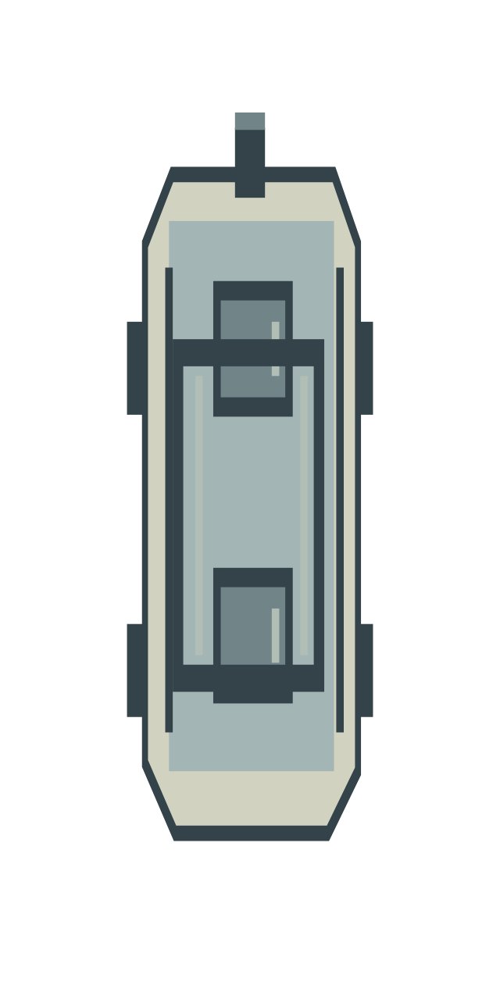
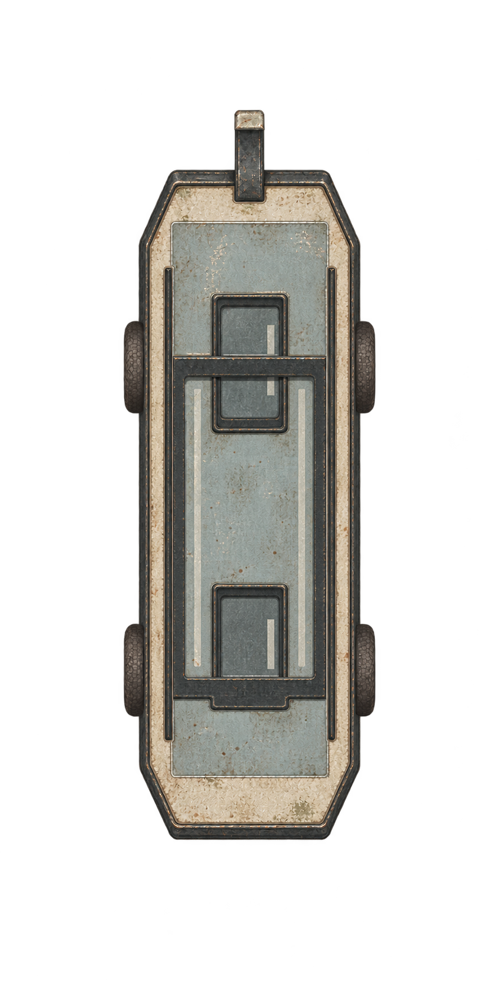
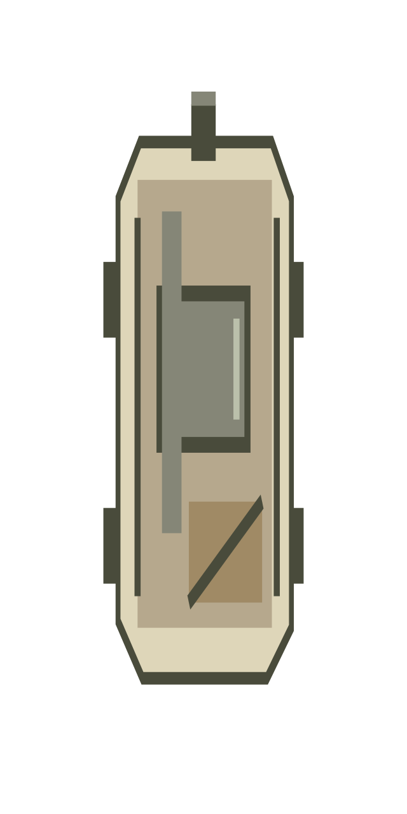
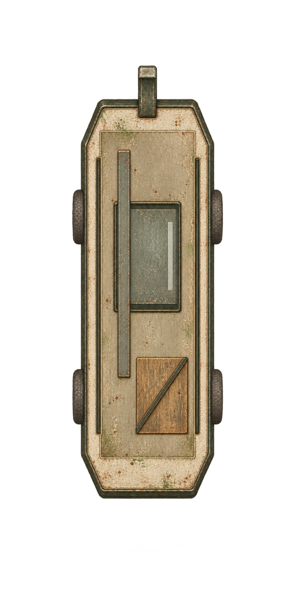
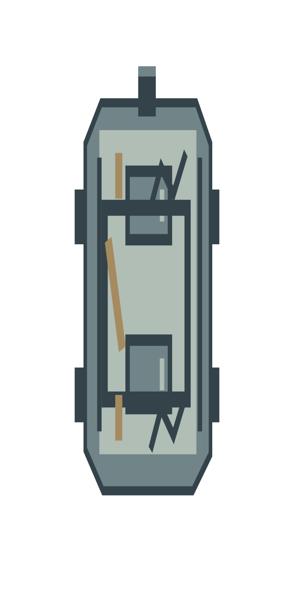
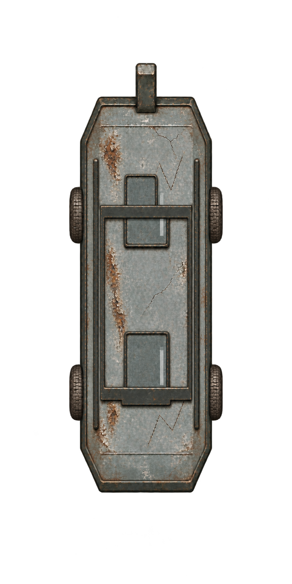
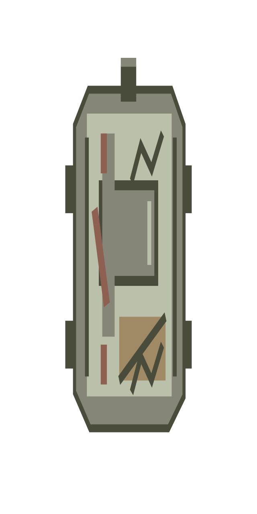
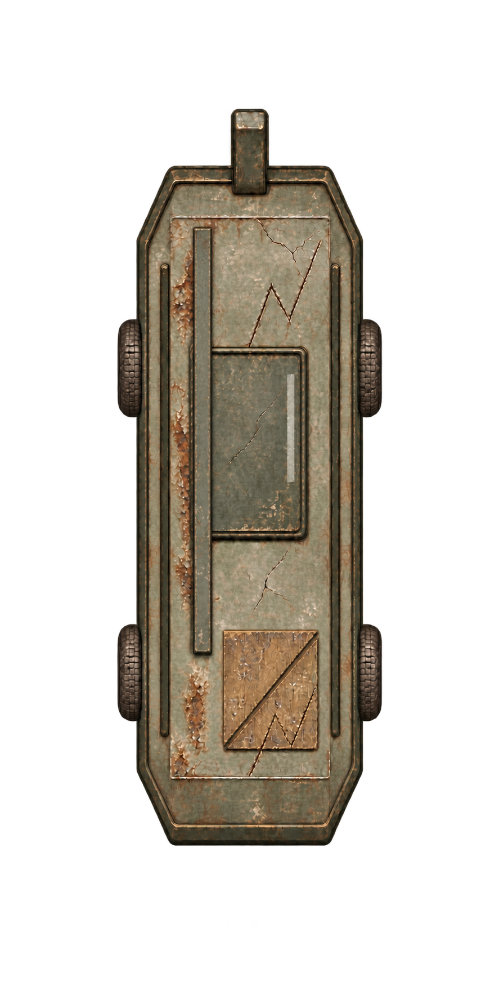

# DEADWALL — Art241 : Caravanes fermées — variantes 1 et 2

**4 PNG finaux et 3 sortie(s) remplacée(s)** sont conservés dans leurs octets natifs, avec les prompts effectivement envoyés, les références exactes, l’historique et les empreintes SHA256.

| Identité de proposition | Sujet | Géométrie déclarée par la source |
|---|---|---|
| `prop:touring-caravan:v1` | Caravane tractable fermée et inoccupée — variante 1 | 2.4 × 6.2 m ; hauteur auteur 2.8 m |
| `prop:touring-caravan:v2` | Caravane tractable fermée et inoccupée — variante 2 | 2.4 × 6.2 m ; hauteur auteur 2.8 m |
| `prop:abandoned-caravan:v1` | Caravane abandonnée fermée et évacuée — variante 1 | 2.4 × 6.2 m ; hauteur auteur 2.8 m |
| `prop:abandoned-caravan:v2` | Caravane abandonnée fermée et évacuée — variante 2 | 2.4 × 6.2 m ; hauteur auteur 2.8 m |

## Sources et périmètre

Base de publication : `6ebd6707251e675a5b75ded23e91dd28339dfe38` ; arbre Git : `33d089eab2bb23f288e66d57c2794f6a38b3ba84`. Sources du moteur inchangées depuis `12e0aa4aa77b9901bd53eb7a8771382a5f753593`.

Ce lot étend la couverture aux variantes 1 et 2 déjà définies par structural205. Les propositions en variante 0 restent conservées. Les objets ont déjà un rendu visible ; aucune nouvelle famille runtime ni nouvelle fonctionnalité ne sont créées.

Les références utilisent drawProp sur les instances auteur exactes, avec la variante de peintre 1 ou 2 et stateAlpha:false, sans objet game. La variante du plan auteur reste distincte. Les dimensions sont des choix de conception, sans certification métrique ou pixel pour pixel du PNG.

## Contrôles et contenu

- `assets/art241/props/` : images finales natives, sans réencodage.
- `references/iterations/` : sorties remplacées lorsqu’une correction a été nécessaire.
- `references/` : références canoniques, images réellement fournies et sources vérifiées contre Git.
- `generation-history.json` : chaque prompt ayant produit un PNG, ses références exactes et sa sortie retenue ou remplacée.
- `records/` : préparation originale et reçus, notamment le rejeu indépendant des références canoniques.
- `qa/` : revue liée au SHA256, décodage PNG, chunks, dimensions de fichier et mesures alpha.
- `gallery.html` : comparaisons canoniques/finales avec les fichiers natifs liés directement.
- `SHA256SUMS.txt` : tous les fichiers du pack, hors manifeste lui-même.

Les pixels d’alpha très faible sont mesurés séparément. Des marges autour du corps visible n’impliquent pas un alpha strictement nul partout autour du sujet. Les métadonnées natives restent préservées par copie exacte des octets.

**Propositions source uniquement.** La fidélité métrique ou pixel pour pixel 1:1 n’est pas certifiée. Échelle, ancrage, orientation, clipping et apparence en jeu restent à qualifier lors d’une intégration distincte. L’assembleur ne modifie aucune source du moteur, sauvegarde, identité, collision, dépendance ou test.

## Comparaison visuelle

### Caravane tractable fermée et inoccupée — variante 1

`prop:touring-caravan:v1`

| Référence canonique existante | Proposition source retenue |
|---|---|
|  |  |

### Caravane tractable fermée et inoccupée — variante 2

`prop:touring-caravan:v2`

| Référence canonique existante | Proposition source retenue |
|---|---|
|  |  |

### Caravane abandonnée fermée et évacuée — variante 1

`prop:abandoned-caravan:v1`

| Référence canonique existante | Proposition source retenue |
|---|---|
|  |  |

### Caravane abandonnée fermée et évacuée — variante 2

`prop:abandoned-caravan:v2`

| Référence canonique existante | Proposition source retenue |
|---|---|
|  |  |
